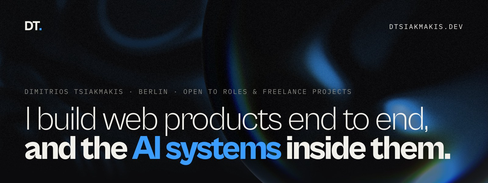
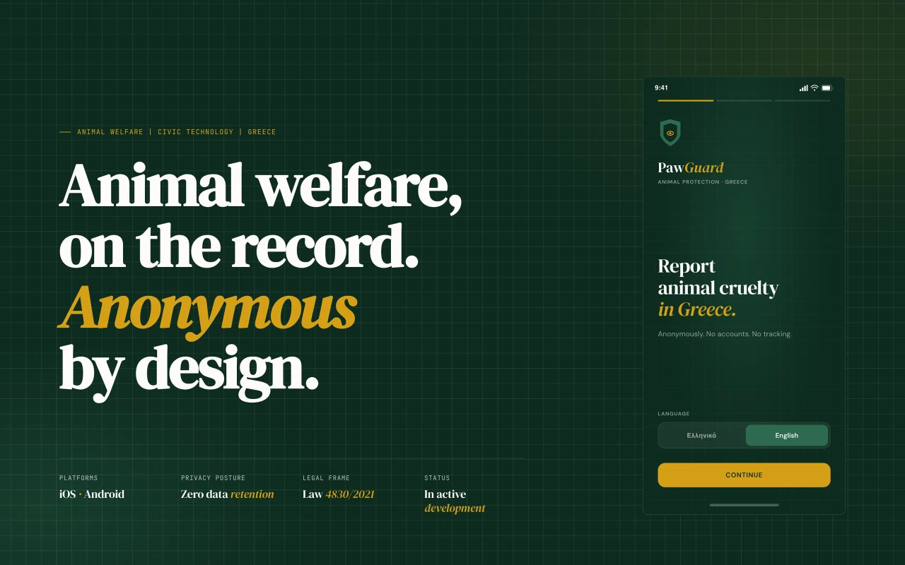
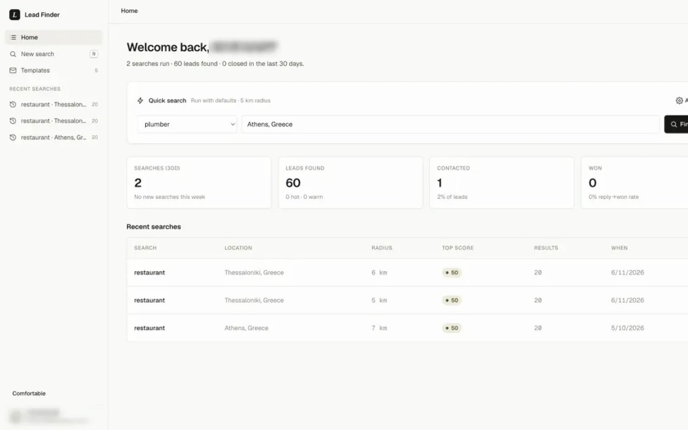
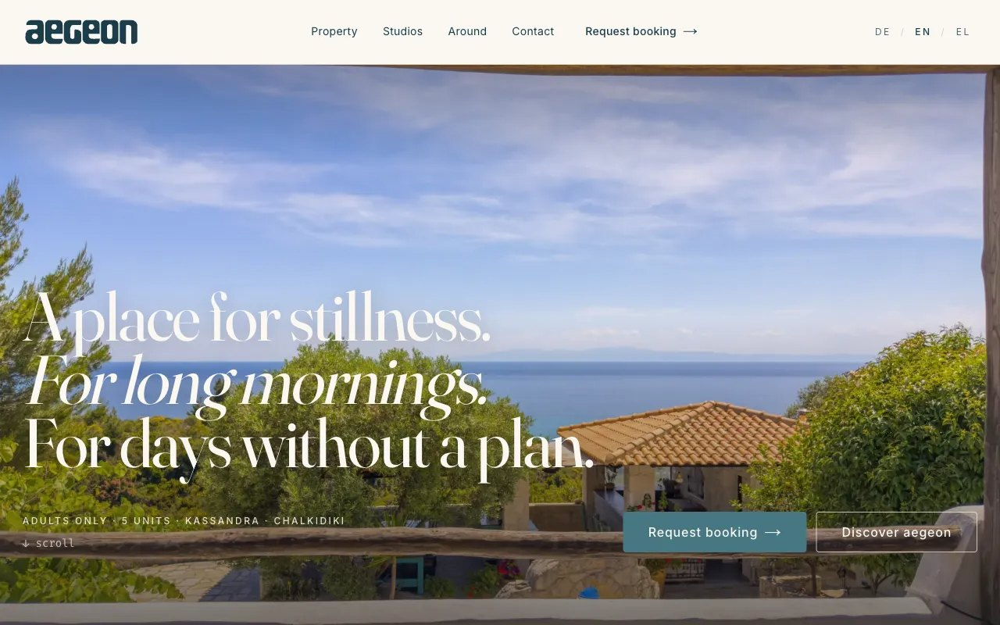
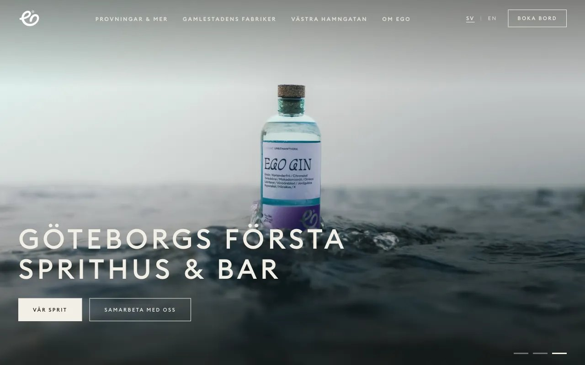
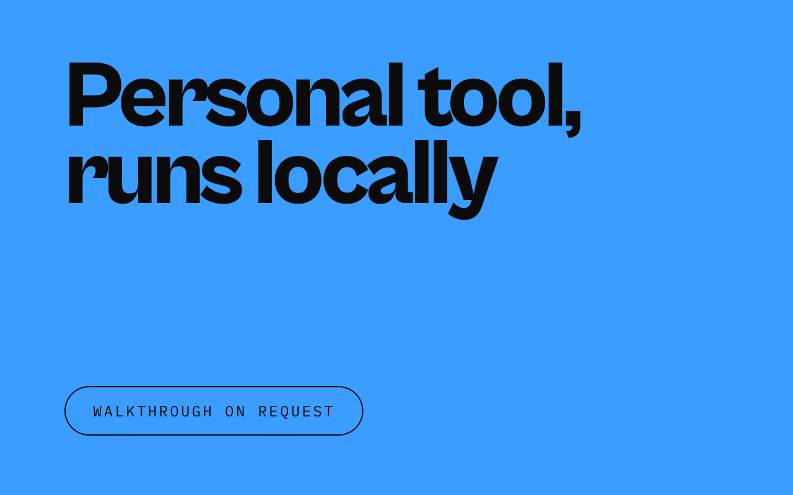
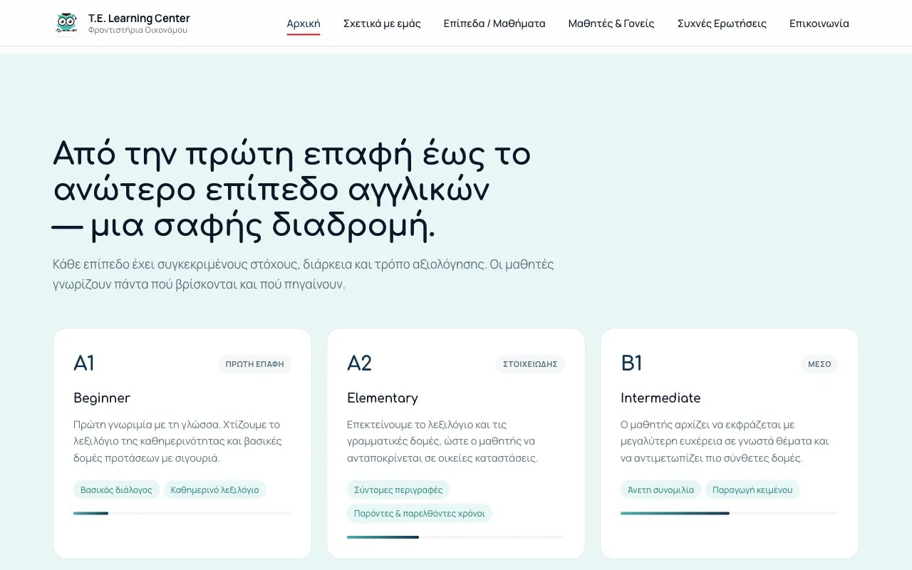
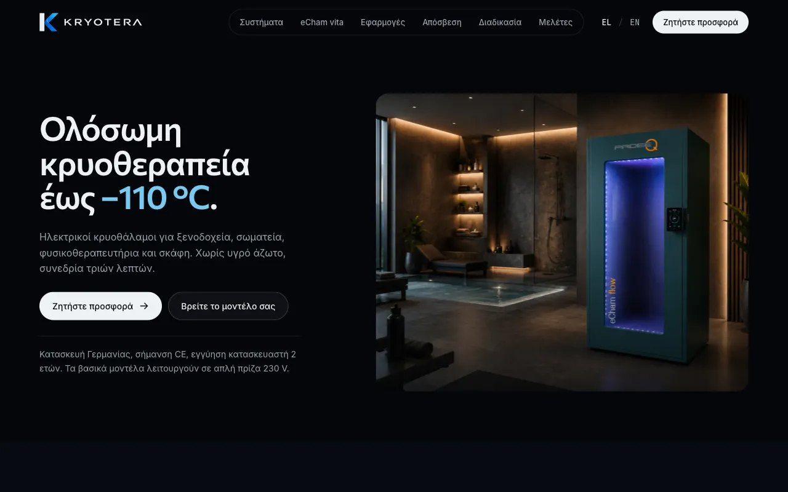
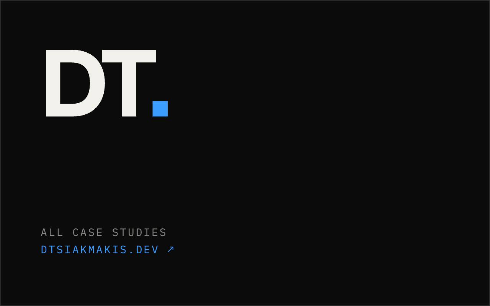
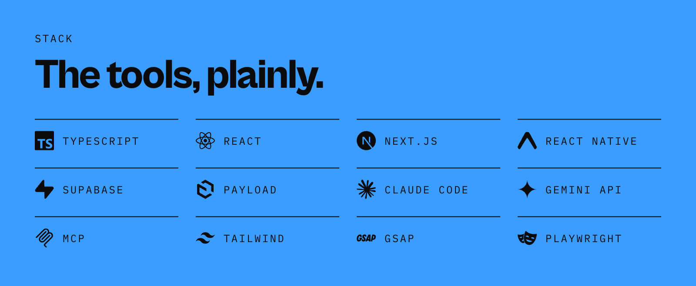

  &nbsp;
  &nbsp;
  

Three years shipping production frontends for German enterprise retail at KPS AG (Dehner, NORMA, Jungheinrich, EP:). Now building multi-agent AI systems and LLM products solo.

EU citizen, open to roles in Germany, Greece and Switzerland (remote-friendly) and to freelance projects.

## Selected work

<table>
<tr>
<td width="50%" valign="top">

 <b>PawGuard</b> In development · pilot pending

An anonymous animal-cruelty reporting app for Greece, built on a zero-retention relay by a four-subagent Claude Code system.

<a href="https://pawguard-one-page.vercel.app">Overview ↗</a> · <a href="https://dtsiakmakis.dev/work/pawguard">Case study ↗</a>
</td>
<td width="50%" valign="top">

 <b>Lead Finder</b> Shipped on Vercel

A lead-gen CRM that scores local-business websites from 0 to 100 using technical, visual and content checks, two of them read by Gemini 2.5 Flash.

<a href="https://dtsiakmakis.dev/work/lead-finder">Case study ↗</a>
</td>
</tr>
<tr>
<td width="50%" valign="top">

 <b>Aegeon</b> Live

A DE/EN/EL booking-request site for a family-run, five-unit rental in Chalkidiki, with Supabase as the single source of truth and an owner-only admin.

<a href="https://aegeon-website.vercel.app">Live ↗</a> · <a href="https://dtsiakmakis.dev/work/aegeon">Case study ↗</a>
</td>
<td width="50%" valign="top">

 <b>Ego Distillers</b> Live

A Swedish/English site for a Gothenburg distillery, bar and restaurant: typed i18n, embedded table booking and a Resend form on a verified domain.

<a href="https://egodistillers.com">Live ↗</a> · <a href="https://dtsiakmakis.dev/work/ego-distillers">Case study ↗</a>
</td>
</tr>
<tr>
<td width="50%" valign="top">

 <b>Career Ops Agent</b> Personal tool, runs locally

A customized fork of santifer/career-ops for an AI-pivot job search, plus a Next.js dashboard I built from scratch over its markdown files, with no database.

<a href="https://dtsiakmakis.dev/work/career-ops">Case study ↗</a>
</td>
<td width="50%" valign="top">

 <b>T.E. Learning Center</b> Live

A Greek-first site for a private language school in Chalkidiki: a custom CSS design system, Greek-subset typography and all copy in one module.

<a href="https://oikonomou.vercel.app">Live ↗</a> · <a href="https://dtsiakmakis.dev/work/te-learning-center">Case study ↗</a>
</td>
</tr>
<tr>
<td width="50%" valign="top">

 <b>Kryotera</b> Live · Imagery: kryora.de (AI renders)

A Greek-first B2B site for whole-body cryotherapy chambers: Greek type done properly, CSS-only motion, a model finder and a Resend enquiry form.

<a href="https://kryotera.gr">Live ↗</a> · <a href="https://dtsiakmakis.dev/work/kryotera">Case study ↗</a>
</td>
<td width="50%" valign="top">

 <b>More on dtsiakmakis.dev</b> Case studies, experience and contact

Each project has a write-up of the decisions behind it. Most client repos are private, so the live sites and case studies are the best way to see the work.

<a href="https://dtsiakmakis.dev">dtsiakmakis.dev ↗</a>
</td>
</tr>
</table>

